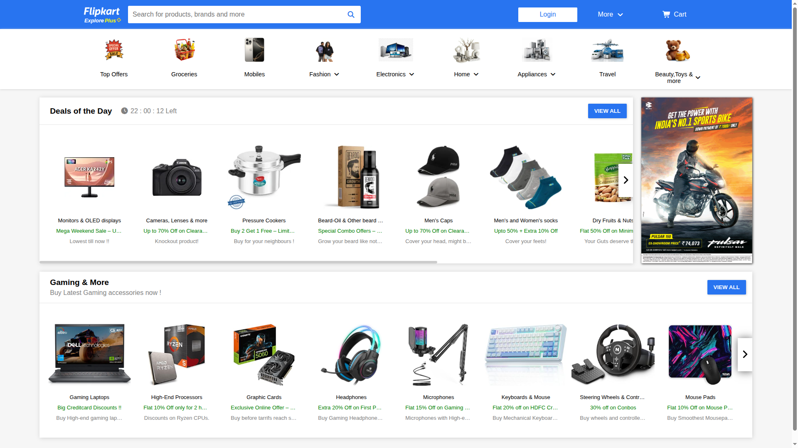
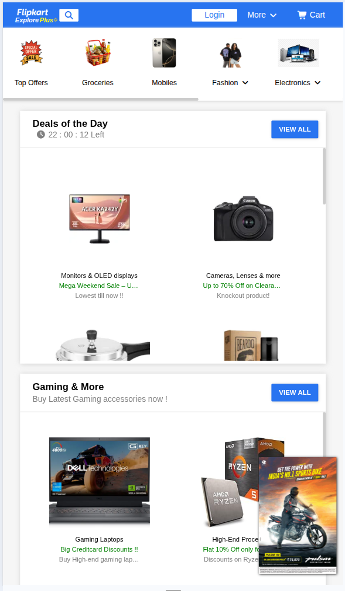
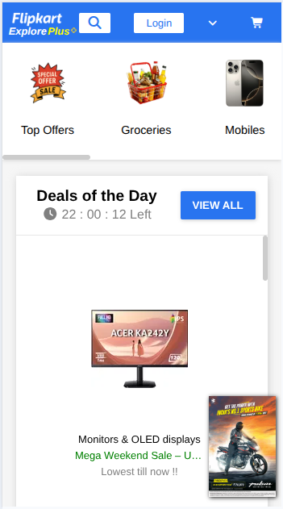

# Responsive E-Commerce Page Assessment

## Overview

This project is a responsive e-commerce website built with HTML and CSS. It demonstrates modern web design principles with a focus on responsiveness and user experience.

## Folder Structure

```
html_css_assessment/
├── index.html    ( Contains HTML structure of the assesment.)
├── styles.css    ( Contains Styles applies to html elements.)
├── images/       ( Contains Images used in the assessment.)
├── screenshots/  ( Contains screenshots presented in readme.md.)
└── README.md     ( Readme file of assessment.)
```

## How to Run

1. Clone or download the project folder

```
   git clone https://github.com/jaimin-dekavadiya-simform/html_css_assessment
```

2. Open `index.html` in your web browser<br>
   `OR` <br>
   Run html file with Live-Server (extension) on VS-code

## Dark Mode

The page supports a light and a dark theme.

- On the first visit it follows the operating system preference (`prefers-color-scheme`).
- The sun/moon button in the header switches the theme manually.
- The choice is saved in `localStorage` under the key `theme` (`light` or `dark`) and is reused on later visits.
- Colours are CSS custom properties defined on `:root` in `style.css`; the dark palette lives under `:root[data-theme="dark"]` (and the matching `prefers-color-scheme` media query).

## Screenshots

### Desktop View



### Tablet View



### Mobile View



## Live Demo

[View Live Demo](https://jaimin-dekavadiya-simform.github.io/html_css_assessment/)

## Video Demonstration

[Watch Demo Video](https://simformsolutionspvtltd-my.sharepoint.com/:v:/g/personal/jaimin_dekavadiya_simformsolutions_com/IQBRfZBaorpxQ6jhn8LJmHg5AcGYvPafKg5o7kGxiaRnNvg?nav=eyJyZWZlcnJhbEluZm8iOnsicmVmZXJyYWxBcHAiOiJPbmVEcml2ZUZvckJ1c2luZXNzIiwicmVmZXJyYWxBcHBQbGF0Zm9ybSI6IldlYiIsInJlZmVycmFsTW9kZSI6InZpZXciLCJyZWZlcnJhbFZpZXciOiJNeUZpbGVzTGlua0NvcHkifX0&email=dharmit.s%40simformsolutions.com&e=CawALW)

## What I Learned

- Semantic HTML structure
- CSS Flexbox and Grid layouts
- Responsive design
- CSS media queries
- Cross-browser compatibility
- Accessibility best practices

## Technologies Used

- HTML5
- CSS3
- Responsive Design Techniques

---
